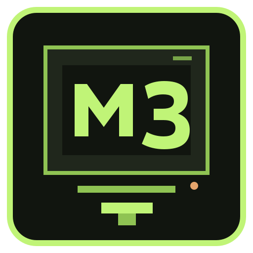

# MiniX8



MiniX8 é uma máquina virtual didática de 8 bits: CPU, 64 KiB de memória, pilha, flags, entrada e saída de terminal, carregador de ROM e monitor de depuração. O núcleo é C11 sem dependências de terceiros, então roda nativamente em Linux (Debian/Ubuntu, Fedora/RHEL e derivados), Windows e em containers. Também pode ser compilado e executado dentro de VMs Linux ou Windows. A versão publicada atual é [v1.1.0](https://github.com/mnl-nox/minix8/releases/tag/v1.1.0); consulte a página de [releases](https://github.com/mnl-nox/minix8/releases) para downloads e checksums.

## Compilar

### Linux (Debian/Ubuntu)

```sh
sudo apt-get install build-essential
make
./minix8 --help
sudo make install
```

### Linux (Fedora/RHEL e derivados)

```sh
sudo dnf group install "Development Tools"
make
./minix8 --help
```

### CMake (Linux, macOS, Windows)

```sh
cmake -S . -B build
cmake --build build --config Release
```

No Windows, abra o diretório no Visual Studio ou rode os comandos acima em um terminal com CMake e MSVC instalados. O executável fica em `build/Release/minix8.exe` para geradores multi-config e em `build/minix8.exe` para MinGW.

### Container

```sh
docker build -t minix8 .
docker run --rm minix8 --help
docker run --rm -it -v "$PWD:/rom:ro" minix8 --rom /rom/program.bin
```

O build compila o programa e executa `make test`. A imagem final roda como usuário sem privilégios e contém apenas o executável. Podman aceita os mesmos comandos. Consulte o [guia Docker/Podman](docs/DOCKER.md) para dependências, execução e erros de acesso ao daemon ou namespaces. No Windows, monte a pasta da ROM com a sintaxe de volume do Docker Desktop.

## Interface gráfica retro

O frontend desktop em Tkinter está pronto para uso: carrega `.rom`/`.bin`, monta `.asm` ou converte `.hex`, oferece execução por passo ou limitada, inspeção de registradores/RAM e entrada de bytes em um visual de terminal fósforo:

```sh
make gui
# ou
python3 scripts/hex_to_rom.py examples/hello.hex /tmp/hello.rom
python3 tools/minix8_gui.py --rom /tmp/hello.rom
```

Requer Python 3/Tkinter, um ambiente gráfico e o executável `minix8`. Veja o [manual da interface gráfica](docs/GUI.md) para Windows, macOS, controles e limitações.

## Usar

Execute uma ROM binária que inicia em `0x0000`:

```sh
./minix8 --rom programa.bin
./minix8 --rom programa.bin --origin 0x8000 --steps 50000
```

Sem ROM, abra o monitor. Com `--monitor`, a ROM é carregada e o monitor permanece aberto para depuração:

```sh
./minix8
./minix8 --rom programa.bin --monitor
```

Comandos: `help`, `regs`, `step [n]`, `run [n]`, `reset`, `load arquivo [endereço]`, `mem endereço [tamanho]`, `set endereço byte`, `quit`. Números aceitam decimal e prefixos `0x`.

Para um programa mínimo que imprime `Oi!`, os bytes são `01 4F 19 01 69 19 01 21 19 1A` (LDA #O, OUT A, LDA #i, OUT A, LDA #!, OUT A, HLT). Salve-os em `oi.bin` e rode `./minix8 --rom oi.bin`.

Veja o conjunto completo de instruções em [docs/ISA.md](docs/ISA.md). A ISA inclui `GETCYC` e `GETCYH`, que permitem ao programa ler os 16 bits inferiores do contador de instruções para medições determinísticas.

## Assembly e dispositivos

Monte fontes da ISA virtual para ROM com o assembler Python incluído:

```sh
python3 tools/minix8_as.py examples/hello.asm /tmp/hello.rom
./minix8 --rom /tmp/hello.rom
python3 tools/minix8_devices.py --json
```

O scanner enumera hardware que Linux/macOS/Windows expõem por suas APIs
usuais, em modo somente leitura. Ele identifica dispositivos do host, mas a CPU
virtual não os controla. Hoje `IN`/`OUT` fornecem apenas console byte a byte; não
há NIC/rede virtual, disco guest, USB passthrough, áudio ou framebuffer. Consulte
a [matriz de periféricos, funcionamento e possibilidades](docs/DEVICES.md), o
[manual do assembler](docs/ASSEMBLY.md), as [referências MINIX 3 e bibliografia](docs/REFERENCES.md)
e a [auditoria de segurança](SECURITY_AUDIT.md).

## Testes e QA

```sh
make test      # testes unitários do núcleo e integração da CLI
make sanitize  # mesmos testes com AddressSanitizer e UBSan
make analyze   # análise estática GCC (-fanalyzer)
make qa        # executa os testes, sanitizers e análise estática
```

Ou use CMake/CTest:

```sh
cmake -S . -B build -DCMAKE_BUILD_TYPE=Debug
cmake --build build --parallel
ctest --test-dir build --output-on-failure
```

Os testes CLI criam ROMs temporárias e verificam execução, entrada/saída, endereço de entrada, parâmetros inválidos, opcode desconhecido, tamanho máximo de ROM e comandos do monitor. `make qa` requer GCC com `-fanalyzer` e um compilador com AddressSanitizer/UBSan. Veja [docs/ARCHITECTURE.md](docs/ARCHITECTURE.md) para a cobertura e as limitações de QA.

## Distribuição ISO

`make iso` cria uma imagem ISO 9660/Joliet com executável, ROM binária pronta, lançadores, fontes e manuais. Python 3 basta; `xorriso` é opcional para Rock Ridge. A ISO é mídia de dados, **não inicializável**, e roda sobre o sistema hospedeiro. A release reúne binários Linux, macOS e Windows. Veja o [guia de início](docs/USER_GUIDE.md), [manual dos comandos](docs/COMMANDS.md) e [detalhes da ISO](docs/ISO.md).

`make boot-iso` cria também uma mídia live x86-64 para VM, com kernel Linux,
BusyBox e MiniX8 pronto para iniciar. O sistema live é um hospedeiro Linux
mínimo para a CPU virtual de 8 bits, não um OS histórico independente. Consulte
o [guia da VM](docs/BOOTABLE_VM.md) e as [ferramentas necessárias](docs/TOOLS.md).

## Licença e componentes de terceiros

O código original do MiniX8 é distribuído sob a **GNU General Public License v3.0 ou posterior (GPL-3.0-or-later)**. Consulte o arquivo [LICENSE](LICENSE). A licença exige que redistribuições de obras derivadas abrangidas mantenham as liberdades previstas pela GPL e cumpram as condições de disponibilização do código-fonte aplicáveis. Componentes externos incluídos na ISO live mantêm suas próprias licenças; veja [THIRD_PARTY_NOTICES.md](THIRD_PARTY_NOTICES.md). A auditoria das versões exatas e dos códigos-fonte dos componentes da ISO live deve acompanhar cada release.

## Site, estudo e comunidade

O [site do MiniX8](https://mnl-nox.github.io/minix8/) reúne visão geral do projeto, áreas técnicas, curiosidades, FAQ, bibliografia introdutória e atualizações via feed Atom das releases. O feed funciona sem coleta de e-mails; uma newsletter por e-mail exigiria um serviço externo e política de privacidade. A prévia da GUI no site é identificada como ilustração, não como captura real do aplicativo.

## Documentação e contribuição

- [Arquitetura da máquina](docs/ARCHITECTURE.md): componentes, ciclo de CPU e limites implementados.
- [ISA](docs/ISA.md): opcodes, operandos, flags, contador de instruções e convenções binárias.
- [Contribuição e mensagens de commit](CONTRIBUTING.md): fluxo de PR e regras Conventional Commits.
- [CI/CD, QA e releases](docs/RELEASING.md): testes, sanitizers, matriz de builds, gatilhos e publicação de versões.
- [Docker e Podman](docs/DOCKER.md): dependências da imagem, testes durante o build, usuário sem privilégios e diagnóstico do host.
- [Política e limites de segurança](SECURITY.md): modelo de ameaça e canal de relato.
- [Limitações](docs/QA.md), [erros e diagnósticos](docs/ERRORS.md), [formato ISO](docs/ISO.md) e [site do projeto](site/index.html).
- [Interface gráfica desktop](docs/GUI.md).
- [Dispositivos: suporte atual, integração e possibilidades](docs/DEVICES.md), [roadmap técnico de periféricos](docs/ROADMAP.md), [issue agregador #15](https://github.com/mnl-nox/minix8/issues/15) e [referências MINIX 3/livros de Andrew S. Tanenbaum](docs/REFERENCES.md).
- [Guia de uso passo a passo](docs/USER_GUIDE.md) e [manual completo dos comandos do monitor e da CPU](docs/COMMANDS.md).
- [Guia da mídia bootável para VM](docs/BOOTABLE_VM.md), [ferramentas](docs/TOOLS.md) e [ajuda do shell live](docs/VM-HELP.txt).

O CI compila em Ubuntu 22.04 x86-64, macOS 14 ARM64 e Windows Server 2022 x86-64; também compila o núcleo em Debian stable e Fedora. Pushes e PRs executam a validação e os builds. Para publicar automaticamente, integre na `main` via squash usando Conventional Commits: `fix:` gera PATCH, `feat:` gera MINOR e uma mudança incompatível marcada com `!`/`BREAKING CHANGE:` gera MAJOR. Os demais tipos passam pelo CI sem criar release. A versão publicada atual é `v1.1.0`; os executáveis, ISOs e checksums produzidos pelo workflow são anexados à release no GitHub.
